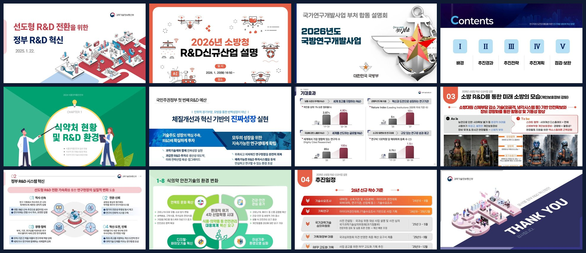
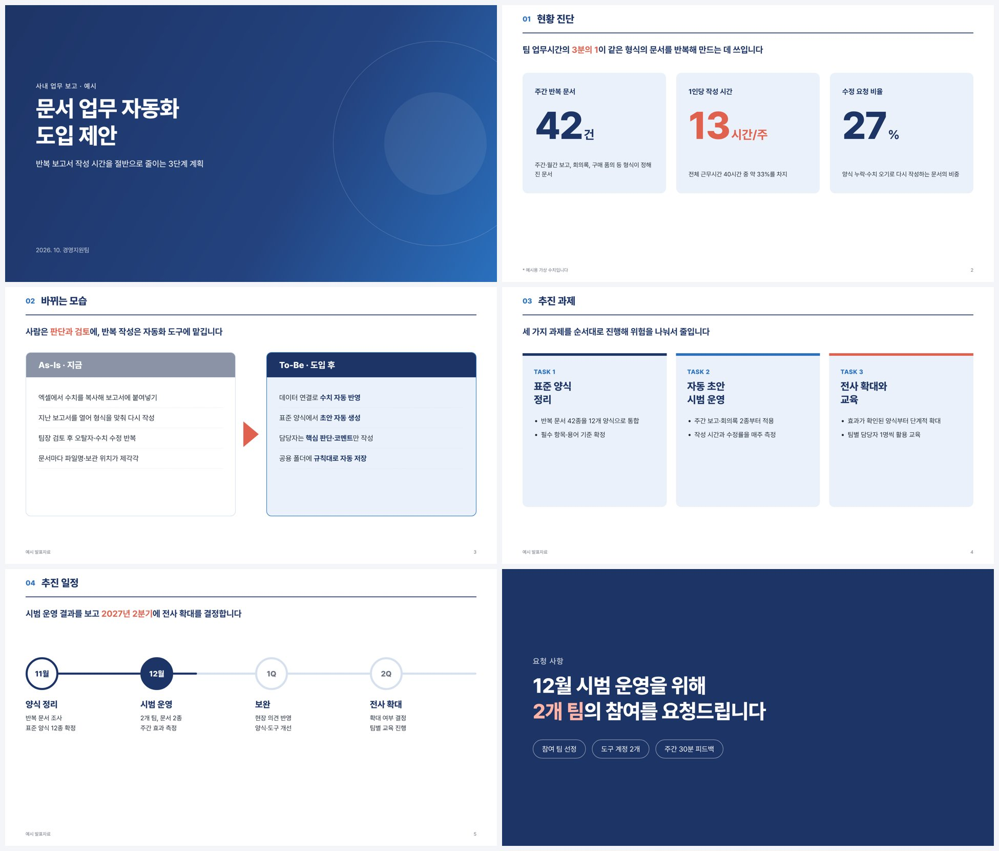

# kor-gov-brief-skill

[English](README.md) · **한국어**

### 정부 발표자료 283개에서 뽑아낸 "잘 만든 슬라이드"의 규칙을, Claude가 바로 쓰는 스킬로.

> 주제만 말하면 Claude가 **검증된 레이아웃 16종과 디자인 규칙**으로 16:9 발표자료를 만듭니다.
> 고객사 제안, 사내 보고, 포트폴리오 어디에나 씁니다.

**레퍼런스 (2020~2026 정부 R&D 부처합동설명회, 32개 덱에서 100장 선별)**



**이 스킬로 만든 예시 (가상의 사내 보고 「설비 예지보전 플랫폼 도입 제안」)**



[레이아웃 갤러리 100장 보기](skills/rnd-reference-deck-style/references/README.md) · [예시 HTML 원본](examples/sample-deck.html) · [SKILL.md 읽기](skills/rnd-reference-deck-style/SKILL.md)

---

## 왜 정부 발표자료인가

한국 정부 부처는 매년 초 수십 개 기관이 같은 자리에서 R&D 설명회를 엽니다. 7년 치를 모으면 같은 목적(복잡한 내용을 많은 사람에게 짧게 설명)을 두고 수백 가지 디자인 시도가 쌓여 있는 셈입니다. 이 스킬은 그 자료를 **내용이 아니라 디자인만** 뜯어본 결과입니다.

- **283개 PDF, 약 17,800쪽**을 모두 목록화하고 화면비·주색·중복을 집계했습니다.
- 그중 **53개를 축소판으로 훑고 32개를 한 장씩 검토**해 스타일 계열 6종을 정했습니다.
- **좋은 페이지 100장**을 1800px로 렌더링해 구도·여백·색·글자 크기·차트·표를 한 장씩 재고, 16개 레이아웃으로 묶었습니다. 스킬의 규칙은 전부 이 측정값에서 나왔습니다.

몇 가지 발견: 슬라이드 225개 중 약 85%가 네이비·블루 한 가지 색 체계를 쓰고, 16:9 비율은 2020년 7%에서 2026년 48%로 늘었습니다.

## 스킬이 Claude에게 알려 주는 것

| | 내용 |
| --- | --- |
| 🎨 **색** | 네이비 `#1D3466` · 블루 `#2A70BE` · 하늘색 `#8FC1F2` · 카드 `#EAF1FA` · 회색 `#8A94A6`(전/As-Is) · 포인트 레드 `#E1614F`(숫자·키워드에만). 전→후는 회색→블루, 분류색은 같은 채도의 4색 한 벌 |
| 🔠 **글자** | 굵은 고딕 제목 + 고딕 본문(Pretendard 등). 1920×1080 기준 표지 80~110px · 간지 번호 90~250px · 제목 바 56~60px · 핵심 문장 44~60px · 큰 숫자 60~150px · 본문 28~36px · 출처 18~22px (pptx는 ÷2 pt) |
| 📐 **틀** | 16:9, 좌우 여백 80px, 상하 60px. 제목 바 3종(전폭 네이비 110~150px · 좌측 짧은 바 · 바 없음) → 핵심 문장 1줄 → 2~4덩이 → 출처·쪽번호. 카드 간격 30~40px, 모서리 12~20px |
| 🧩 **레이아웃 16종** | 표지 · 목차 · 간지 · 핵심 메시지 · 수치 카드 · 차트 · As-Is/To-Be · 카드형 과제 · 구조 도식 · 프로세스 · 타임라인 · 지도 · 표 · 사업 상세 · 사진·아이콘 카드 · 마무리. 유형마다 측정 치수와 사례 3~10장 |
| 🎭 **스타일 6계열** | 네이비 정책형 · 아이소메트릭 일러스트형 · 다크 사진형 · 컬러 테마형 · 표 중심형 · 인쇄 자료집 ([설명](skills/rnd-reference-deck-style/references/style-families.md)) |
| 🚫 **피할 것** | 한 장에 표 두 개, 형광 강조 남발, 일러스트와 스톡사진 섞기, 4:3 비율, 22px 미만 본문 |
| 🔁 **공통 문법** | 한 장 한 메시지 · 핵심어만 색 · 큰 숫자 작은 단위 · 회색(전)→블루(후) · 알약 라벨 · 네이비 결론 띠 · 장식은 한 덱에 한 종류 |

## 설치

### Claude Code

```bash
git clone https://github.com/jungom3123/kor-gov-brief-skill.git
mkdir -p ~/.claude/skills
cp -r kor-gov-brief-skill/skills/rnd-reference-deck-style ~/.claude/skills/
```

한 프로젝트에서만 쓰려면 `~/.claude/skills/` 대신 그 프로젝트의 `.claude/skills/`에 복사하세요.

### Claude 앱 (claude.ai)

```bash
cd kor-gov-brief-skill/skills
zip -r rnd-reference-deck-style.zip rnd-reference-deck-style
```

만든 ZIP을 Claude 설정의 스킬(Skills) 메뉴에서 업로드합니다.

## 사용 예시

스킬이 설치되어 있으면 이렇게 말하기만 하면 됩니다.

```text
신규 고객사에 데이터 분석 서비스를 제안하는 10장짜리 발표자료를 만들어 줘.
고객사 브랜드 색은 #0F9D58이야.
```

```text
이번 분기 팀 성과를 경영진에게 보고하는 자료를 만들어 줘.
핵심 수치는 매출 18% 증가, 신규 고객 42곳, 이탈률 3.1%야.
```

```text
내 포트폴리오용으로 프로젝트 3개를 소개하는 슬라이드를 아이소메트릭 일러스트형으로 구성해 줘.
```

Claude는 용도에 맞는 스타일 계열을 고르고, 슬라이드마다 레이아웃 유형을 정한 뒤, 갤러리 이미지를 열어 구도를 참고해서 만듭니다.

## 레포 구성

```text
kor-gov-brief-skill/
├── skills/rnd-reference-deck-style/   ← 이 폴더가 스킬 본체
│   ├── SKILL.md                       디자인 규칙과 작업 순서
│   └── references/
│       ├── README.md                  레이아웃 갤러리 (100장, 출처·유형별 규칙)
│       ├── style-families.md          스타일 계열 6종
│       └── layouts/01_표지 … 16_마무리/
├── examples/
│   ├── sample-deck.html               규칙만으로 만든 예시 9장 (HTML)
│   └── images/                        예시 슬라이드 이미지
├── docs/                              README용 이미지
├── LICENSE                            MIT (레퍼런스 이미지 제외)
└── NOTICE.md                          레퍼런스 이미지 출처와 권리 안내
```

## 내 스타일로 바꿔 쓰기

이 레포를 포크한 뒤 `SKILL.md`의 **2. 기본 틀**에서 색과 글꼴만 바꾸면 내 브랜드용 스킬이 됩니다. 다른 레퍼런스를 모았다면 `references/layouts/` 폴더 구조를 그대로 두고 이미지만 바꿔 넣으세요.

## 라이선스와 출처

- `SKILL.md`, 문서, `examples/`는 [MIT 라이선스](LICENSE)입니다. 예시 슬라이드는 레퍼런스 이미지를 쓰지 않고 규칙만으로 새로 만들었습니다.
- `references/layouts/`의 이미지 100장은 **MIT 대상이 아니며** 각 기관에 권리가 있습니다. 디자인 공부용으로만 두었고, 자세한 내용과 삭제 요청 방법은 [NOTICE.md](NOTICE.md)에 있습니다.

