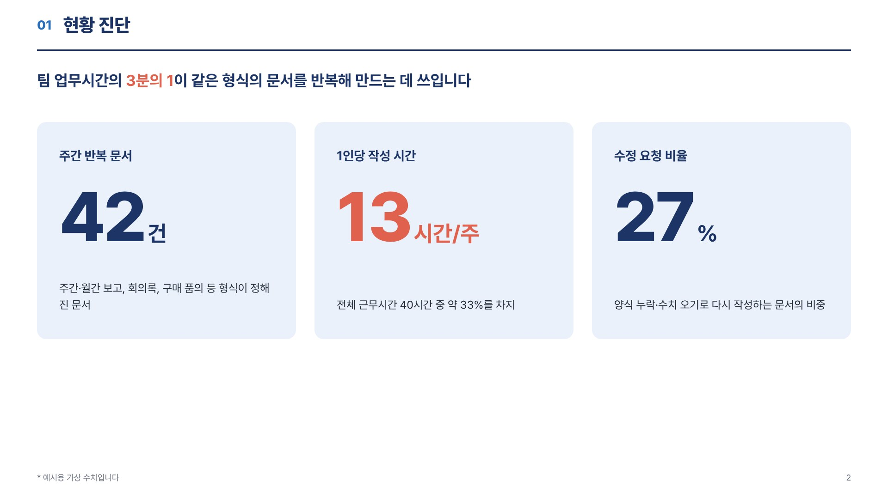
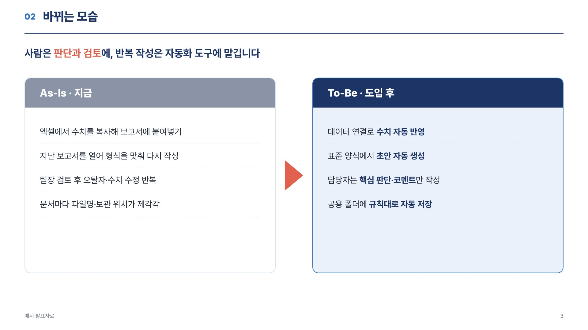
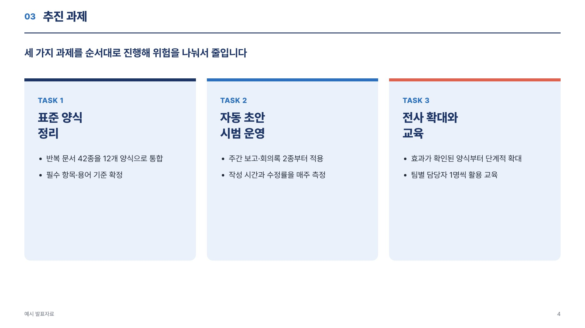
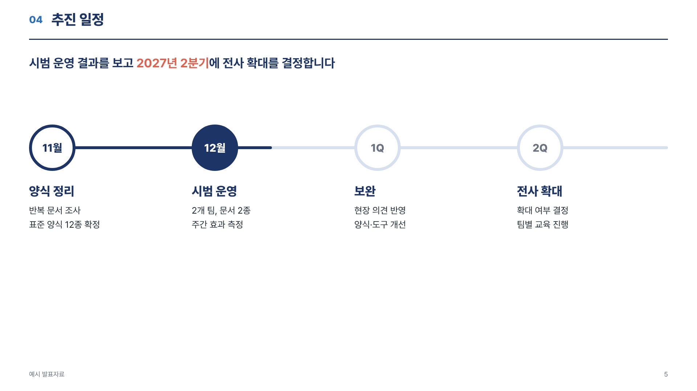

# 예시 · Example

가상의 사내 보고 「문서 업무 자동화 도입 제안」을 `SKILL.md`의 규칙만으로 만든 6장입니다. 레퍼런스 이미지는 쓰지 않았고, 수치는 모두 가상입니다.

| 슬라이드 | 레이아웃 유형 |
| --- | --- |
|  | 01 표지 |
|  | 04 핵심 메시지 + 수치 강조 |
|  | 06 As-Is / To-Be 비교 |
|  | 07 카드형 전략과제 |
|  | 09 타임라인 |
|  | 13 마무리 |

`sample-deck.html`을 브라우저로 열면 원본 크기(1920×1080)로 볼 수 있습니다. 글꼴은 Pretendard가 설치되어 있으면 그것을, 없으면 시스템 고딕을 씁니다.
